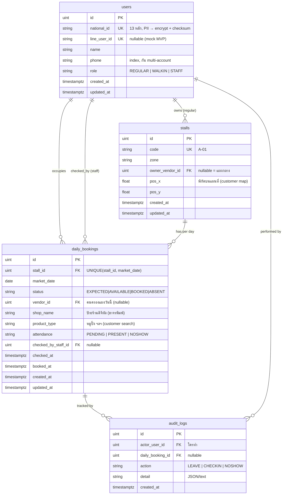

# TaladSync — System Design Document

> ระบบจัดการแผงตลาดสดรายวัน (Daily Market Stall Management System)
> แก้ Pain Point จริงของตลาดสดไทย: การบริหารแผงประจำ, การแย่งแผงของขาจร, และการเช็คชื่อหน้างาน (roll-call)

> **เก็บเงิน 20 บาท:** เจ้าหน้าที่เก็บสดหน้างานเอง — **ไม่ track ในระบบ MVP** (ย้ายไป Phase 2)

---

## 1. Overview

**ปัญหาที่แก้ (Problem Statement)**
- แม่ค้าประจำหยุดกะทันหันโดยไม่มีใครรู้ → แผงว่างทิ้งเปล่า เสียรายได้เทศบาล
- ขาจร "แย่งแผง" หน้างานวุ่นวาย ไม่มีกติกา → เกิดปัญหา race ของจริงหน้างาน
- ระบบจองกับความเป็นจริงหน้างานไม่ตรง → ไม่รู้ว่าใครมา/ไม่มา แม้จองไว้แล้ว

**คุณค่าหลัก (Core Value)**
1. **Concurrency-safe stall booking** — จัดการการแย่งจองแผงพร้อมกันตอน 13:00 น. ด้วย conditional atomic UPDATE
2. **On-site roll-call (attendance)** — เจ้าหน้าที่เช็คว่าแม่ค้ามา/ไม่มา พร้อม audit trail (ไม่ track เงิน 20 บ. ใน MVP)
3. **Real-time market directory** — ลูกค้าค้นหาร้านเจอแม้ขาจรเปลี่ยนแผงทุกวัน

**Architecture Decision สำคัญ**
- **Modular Monolith** (ไม่ใช่ microservices) — deploy ก้อนเดียว, DB เดียว เพื่อให้ transaction + row lock ทำงานเต็มประสิทธิภาพ
- **Clean Architecture** ข้างใน — แยก business logic ออกจาก framework (GORM/Fiber) เพื่อ testability
- เลือกตามหลัก **YAGNI**: ออกแบบ scale path ไว้ แต่ไม่ implement จนกว่าจะจำเป็นจริง

---

## 2. Tech Stack

| Layer | Technology | เหตุผล |
|---|---|---|
| **Frontend** | Vue 3 (`<script setup>`) + Vite | reactive, build เร็ว |
| | Tailwind CSS | utility-first, ทำ UI เร็วและ cohesive |
| | Pinia | state management (auth/role) |
| | Vue Router | route แยกตาม role |
| **Backend** | Go 1.24 + Fiber v2 | performance สูง, รับ burst ได้ดี |
| | GORM | ORM |
| | `golang-jwt/jwt` | authentication token |
| | `robfig/cron` | background worker (cron 00:00) — Phase 2 |
| **Database** | PostgreSQL 17 | conditional UPDATE, unique constraint, partial index |
| **Infra (dev)** | Docker Compose | `docker compose up` รันได้ทันที |
| **Testing** | Go `testing` + `testcontainers-go` | **concurrent test กับ DB จริง** (killer demo) |
| **Integration** | LINE LIFF / Messaging API | **mock ใน MVP**, ซ่อนหลัง interface |

---

## 3. High-Level Architecture

> เส้นทึบ = ทำใน MVP | เส้นประ (╌) = Scale Path เปิดใช้ภายหลัง

```
┌──────────────────────────────────────────────────────────────────────┐
│                          CLIENT LAYER                                   │
│                                                                         │
│   [Vendor]               [Staff]                [Customer]              │
│   Vue 3 SPA              Vue 3 SPA               Vue 3 SPA              │
│   mock LIFF              Responsive web          Public (no-login)     │
│   role: REGULAR/WALKIN   role: STAFF             read-only directory   │
└───────┬──────────────────────┬───────────────────────┬────────────────┘
        │                      │                        │
        └──────────────────────┼────────────────────────┘
                               │  HTTPS / REST (JSON) + JWT
                               │
        ┌╌╌╌╌╌╌╌╌╌╌╌╌╌╌╌╌╌╌╌╌╌╌▼╌╌╌╌╌╌╌╌╌╌╌╌╌╌╌╌╌╌╌╌╌╌╌╌┐
        ╎  [Load Balancer / Nginx]   ← SCALE PATH         ╎
        ╎   (เปิดเมื่อมีหลายตลาด / หลาย instance)          ╎
        └╌╌╌╌╌╌╌╌╌╌╌╌╌╌╌╌╌╌╌╌╌╌┬╌╌╌╌╌╌╌╌╌╌╌╌╌╌╌╌╌╌╌╌╌╌╌╌┘
                               │
┌──────────────────────────────▼─────────────────────────────────────────┐
│            APPLICATION LAYER — Go + Fiber  (1 binary ใน MVP)            │
│                                                                         │
│   ┌──────────────── Middleware chain ────────────────┐                 │
│   │ Recover · Logger · Auth(JWT) · RoleGuard ·        │                 │
│   │ RateLimit · Idempotency                           │ ← กัน burst 13:00│
│   └───────────────────────┬───────────────────────────┘                │  
│                           │                                             │
│   handler/  ── usecase/ ── domain/ ── repository/   (Clean Architecture)│
│                           │                                             │
│   modules: [booking] [stall] [payment] [admin] [user]                  │
│                           │                                             │
│   ┌───────────────────────┴──────────┐                                  │
│   │ Background Worker (cron 00:00)    │                                  │
│   │  • สร้าง daily_bookings ทุกแผง    │                                  │
│   │  • ปล่อยแผงคนลายาวลง pool          │                                  │
│   └──────────────────────────────────┘                                  │
│        │                          │                    ╎(scale)         │
│        │ tuned connection pool    │                    ╎                │
└────────┼──────────────────────────┼────────────────────╎────────────────┘
         │                          │                     ╎
  ┌──────▼─────────┐      ┌─────────▼─────────┐   ┌╌╌╌╌╌╌╌▼╌╌╌╌╌╌╌┐
  │ PostgreSQL     │      │ LINE Platform     │   ╎ [Redis]       ╎
  │ Primary        │      │ (mock ใน MVP)     │   ╎ rate-limit /  ╎
  │  • row lock /  │      │  • Login (LIFF)   │   ╎ dist. lock    ╎
  │    cond.update │      │  • Push (Flash)   │   └╌╌╌╌╌╌╌╌╌╌╌╌╌╌╌┘
  └──────┬─────────┘      └───────────────────┘
         ╎ (scale)
  ┌╌╌╌╌╌╌▼╌╌╌╌╌╌╌╌┐
  ╎ Read Replica  ╎  ← customer directory อ่านอย่างเดียว แยก read load
  └╌╌╌╌╌╌╌╌╌╌╌╌╌╌╌┘
```

### Scaling Strategy (สำคัญ: รู้ว่าคอขวดอยู่ตรงไหน)

ประเมิน load จริง: ตลาด 1 แห่ง ขาจร ~100–300 คน กดพร้อมกันใน ~5 วินาที ≈ **~60 req/s peak**
ซึ่ง Go instance เดียวรับได้สบาย → **คอขวดไม่ใช่ throughput ที่ app layer แต่คือ lock contention ที่ row เดียวใน DB**

| Component | เปิดใช้เมื่อ | แก้ปัญหา |
|---|---|---|
| Connection pool tuning | **MVP** | กัน DB connection ตัน (คอขวดจริง) |
| RateLimit + Idempotency | **MVP** | กันกดรัว / กดซ้ำตอนเน็ตตลาดหลุด |
| Fast-fail (409) | **MVP** | ไม่ให้ค้างรอ lock นาน |
| Load Balancer + N instances | หลายตลาด | กระจาย traffic (ไม่ช่วย row contention) |
| Read Replica | customer directory อ่านหนัก | แยก read ออกจาก booking write |
| Redis | ต้อง distributed lock (หลาย DB) | rate-limit รวม / dist. lock |

---

## 4. Database Schema

### ERD



### หลักการออกแบบ (Design Rationale)

1. **แยก `stalls` (master data) ออกจาก `daily_bookings` (transactional)**
   แผงเป็นข้อมูลคงที่ / สถานะรายวันเปลี่ยนทุกวัน → query "วันนี้แผงไหนว่าง" ง่าย และมีแถวให้ lock

2. **`UNIQUE(stall_id, market_date)`** — เกราะชั้น DB กัน double-booking แม้ logic แอปพลาด

3. **State machine ของ `status`:**
   ```
   EXPECTED ──(แม่ค้าแจ้งหยุด / cron ลายาว)──► AVAILABLE
   EXPECTED ──(staff Force Absent)──────────► AVAILABLE
   AVAILABLE ──(ขาจรจอง: conditional UPDATE)──► BOOKED
   ```
   `attendance` เป็น lifecycle แยก (staff เช็คมา/ไม่มา — ไม่เปลี่ยน `status` ตอน NOSHOW ใน MVP)

4. **`shop_name` / `product_type` อยู่ใน `daily_bookings`** (ไม่ใช่ `users`)
   เพราะขาจรเปลี่ยนแผง/เปลี่ยนสินค้าได้ทุกวัน → customer directory อ่าน real-time จากที่นี่

5. **`national_id` = PII อ่อนไหว (PDPA)**
   - ใช้กัน Sybil attack (1 คน = 1 เลขบัตร) และผูกสิทธิ์/blacklist
   - **Production ต้อง:** encrypt at rest, เก็บ hash คู่สำหรับ unique check, validate checksum หลักที่ 13, mask ตอนแสดงผล, log การเข้าถึงใน `audit_logs`
   - **MVP:** ใส่ field + validate checksum ก่อน, เขียน note ว่า production ต้อง encrypt

6. **`audit_logs`** — LEAVE / CHECKIN / NOSHOW เก็บ log → accountability (BOOK audit = Phase 2 polish)

### GORM Models (MVP)

```go
type User struct {
    ID         uint    `gorm:"primaryKey"`
    NationalID string  `gorm:"uniqueIndex;size:13"`  // PII → encrypt ใน production
    LineUserID *string `gorm:"uniqueIndex;size:64"`  // nullable (mock ใน MVP)
    Name       string  `gorm:"size:100"`
    Phone      string  `gorm:"size:20;index"`
    Role       string  `gorm:"size:20;index"`        // REGULAR | WALKIN | STAFF
    CreatedAt  time.Time
    UpdatedAt  time.Time
}

type Stall struct {
    ID            uint   `gorm:"primaryKey"`
    Code          string `gorm:"uniqueIndex;size:20"` // "A-01"
    Zone          string `gorm:"size:50"`
    OwnerVendorID *uint  `gorm:"index"`               // NULL = แผงกลาง
    Owner         *User  `gorm:"foreignKey:OwnerVendorID"`
    PosX          float64
    PosY          float64
    CreatedAt     time.Time
    UpdatedAt     time.Time
}

type DailyBooking struct {
    ID            uint      `gorm:"primaryKey"`
    StallID       uint      `gorm:"not null;uniqueIndex:idx_stall_date"`
    MarketDate    time.Time `gorm:"type:date;not null;uniqueIndex:idx_stall_date"`
    Status        string    `gorm:"size:20;index"`             // EXPECTED|AVAILABLE|BOOKED|ABSENT
    VendorID      *uint     `gorm:"index"`
    ShopName      string    `gorm:"size:100"`
    ProductType   string    `gorm:"size:100;index"`
    Attendance       string    `gorm:"size:20;default:'PENDING';index"`
    CheckedByStaffID *uint
    CheckedAt        *time.Time
    BookedAt         *time.Time
    CreatedAt     time.Time
    UpdatedAt     time.Time
}

type AuditLog struct {
    ID             uint   `gorm:"primaryKey"`
    ActorUserID    uint   `gorm:"index"`
    DailyBookingID *uint  `gorm:"index"`
    Action         string `gorm:"size:30;index"`  // LEAVE | CHECKIN | NOSHOW
    Detail         string `gorm:"type:text"`
    CreatedAt      time.Time
}
```

---

## 5. API Contract (MVP)

Base URL: `/api`  · Auth: `Authorization: Bearer <JWT>` (ยกเว้น public endpoints)

| Method | Endpoint | Role | คำอธิบาย |
|---|---|---|---|
| `POST` | `/api/auth/mock-login` | public | mock login เลือก role → คืน JWT |
| `GET` | `/api/stalls/available?date=` | WALKIN | ดูแผงว่างวันนั้น |
| `GET` | `/api/bookings/mine?date=` | WALKIN | การจองของ vendor วันนี้ |
| `POST` | `/api/bookings` | WALKIN | **จองแผง (conditional UPDATE)** |
| `GET` | `/api/vendor/mine?date=` | REGULAR | แผงที่เป็นเจ้าของ + สถานะวันนี้ |
| `POST` | `/api/vendor/leave` | REGULAR | แจ้งหยุด |
| `GET` | `/api/staff/checklist?date=` | STAFF | roll-call ทุกแผงที่มีคน |
| `POST` | `/api/bookings/:id/attendance` | STAFF | เช็คมา/ไม่มา (idempotent) |
| `GET` | `/api/staff/summary?date=` | STAFF | สรุป present / noshow / pending |
| `GET` | `/api/directory?q=` | public | customer directory (real-time) |

### Response conventions
- `200 OK` — สำเร็จ
- `409 Conflict` — แผงถูกจองไปแล้ว (fast-fail, ไม่ค้างรอ lock)
- `429 Too Many Requests` — กดรัวเกิน rate limit
- `401 / 403` — auth / role ไม่ผ่าน

---

## 6. MVP Scope vs Phase 2

### ✅ MVP (ไข่แดง — ส่งเฟสแรก)
- Mock login 3 roles + JWT + RoleGuard
- **Booking API + conditional UPDATE + concurrent test** (killer feature)
- แจ้งหยุด → ปล่อยแผงลง pool
- Staff roll-call (attendance) + audit log (LEAVE/CHECKIN/NOSHOW)
- Customer directory (read-only, public)
- Seed + `SeedDailyBookingsForToday` + `-reseed` dev flag
- Docker Compose + README + frontend F1–F4

### 🔜 Phase 2 (ออกแบบไว้ — ยังไม่ทำ)
- LINE LIFF / Push จริง (Flash Drop)
- Financial tracking (เก็บเงิน 20 บ. ในระบบ + สรุปยอด)
- โควตาวันหยุด + แจ้งหยุดฉุกเฉิน (2 ครั้ง/เดือน)
- ลาพักยาว + flow อนุมัติ
- Force Absent + ปุ่มโทรหาแม่ค้า
- แจ้งมาช้า (late arrival lock)
- เลขบัตรประชาชน encryption + PDPA compliance เต็มรูปแบบ
- ตารางเพิ่ม: `leave_requests`, `holiday_quotas`, `emergency_leaves`

---

## 7. Implementation Order

```
1) Schema + GORM models + migration + seed data
2) Auth (mock) + JWT middleware + RoleGuard
3) Booking API + row lock + concurrent test   ← หัวใจ ทำให้เสร็จก่อน
4) Vendor leave / Staff checklist / Pay / Summary API
5) Frontend 3 surfaces (vendor / staff / customer)
6) Docker Compose + README + portfolio polish
```

---

## 8. Resume / Interview Highlights

- **Concurrency control**: conditional atomic UPDATE + partial unique index — verified ด้วย 50-goroutine integration test
- **Architecture trade-offs**: เลือก Modular Monolith over microservices (เลี่ยง distributed transaction), Pessimistic lock over Optimistic (เลี่ยง retry storm), ประเมินด้วยตัวเลขว่า LB ไม่ใช่คอขวด
- **Production concerns**: idempotency, audit trail สำหรับเงินสด, PII/PDPA awareness, connection pool tuning
- **Clean Architecture**: แยก domain logic ออกจาก framework → testable, maintainable
